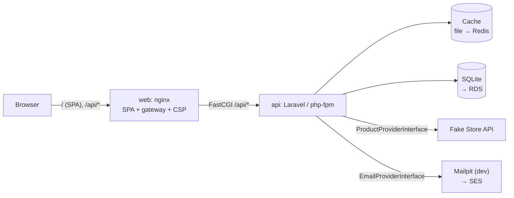
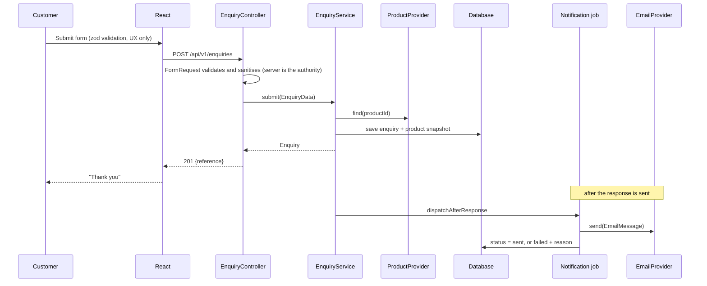

# Architecture

How the catalogue is put together, why, and how to change it. Scope and assumptions live in [docs/spec.md](docs/spec.md); trade-offs in [DECISIONS.md](DECISIONS.md).

## Goals that shaped the design
The brief says the **product data source, the look and feel, and the email provider will all change**, and that the PoC must be a foundation rather than a throwaway. So the design puts a seam exactly where change is expected, and nowhere else:

| Expected to change | Seam |
|---|---|
| Product data source | `ProductProviderInterface` |
| Email provider | `EmailProviderInterface` |
| Look and feel | React components + design tokens (`frontend/src/styles/tokens.css`); no business logic in the UI |

## System overview

One origin for the browser (no CORS). The SPA talks only to `/api/v1`; it never calls the Fake Store API. This is enforced by tests: the frontend suite fails any request that is not mocked and asserts every call targets our own origin.

## Backend layers
```
Controller → FormRequest → Service → Contract ← Infrastructure → external system
                              │
                              └── DTOs (immutable) cross every boundary
```

| Layer | Folder | Responsibility | Must not |
|---|---|---|---|
| Controller | `app/Http/Controllers/Api/V1` | Parse request, call **one** service method, return a Resource | Hold rules, call `Http`, query models |
| Form Request | `app/Http/Requests` | Validate and normalise input (trim, strip control characters), produce a DTO | Run business logic |
| Resource | `app/Http/Resources` | Shape public JSON | Compute anything |
| Service | `app/Services` | Business rules: featured, top-rated split, search, enquiry flow, email wording | Know the Fake Store JSON or the mail transport |
| Contract | `app/Contracts` | Capabilities the app needs | Leak vendor details |
| Infrastructure | `app/Infrastructure` | Implement a contract (HTTP, cache, SMTP) | Contain app rules |
| DTO | `app/DTOs` | Immutable typed data (`readonly`); money is integer cents | Behave like a model |
| Job | `app/Jobs` | Send the sales notification after the response | Decide email content |
| Providers | `app/Providers` | **Composition root**: bind contracts to implementations from config | |

These rules are executable: `tests/Architecture/LayersTest.php` fails the build if a controller touches the HTTP client or an integration, if a service depends on infrastructure or facades, if a DTO is mutable or depends on the framework, if a job or service talks to the mail transport, or if production code depends on tests.

> Naming: `app/Providers` holds Laravel *service providers* (wiring). The data-source and email *providers* the brief talks about are in `app/Infrastructure`. They are different things.

### Product side
```
CatalogueService ──► ProductProviderInterface
                          ▲
                          │ implements
        CachingProductProvider  (decorator: stale-if-error, lock)
                          │ wraps
        FakeStoreProvider ──► FakeStoreMapper ──► FakeStore JSON  (only place that knows the shape)
        InMemoryProductProvider  (tests; template for a new source)
```
`CatalogueSettings` (a DTO built from config) carries business settings such as the curated featured IDs, so services never read config.

### Enquiry side
```
EnquiryController → StoreEnquiryRequest → EnquiryService ──► Enquiry (DB)
                                              │
                                              └─ SendEnquiryNotification (after response)
                                                    ├─ EnquiryEmailComposer  (what the email says)
                                                    └─ EmailProviderInterface (how it is delivered)
```
Composition (wording) and transport are separate: replacing SES with another provider never touches the email text, and rewording never touches the transport.

## Request flows

### Browse (`GET /api/v1/categories/mens-clothing`)
1. React page calls `useCategory(slug)` (TanStack Query, 5-minute client cache).
2. nginx forwards `/api/*` to php-fpm; Laravel assigns a request id and applies the read throttle.
3. `CategoryController` calls `CatalogueService::category()`.
4. The service asks `ProductProviderInterface` (bound to `CachingProductProvider`).
5. Cache hit: return. Miss: take a lock, call `FakeStoreProvider`, map to DTOs, store fresh (10 min) and stale (24 h) copies.
6. The service splits top-rated from the rest; a Resource shapes the JSON; the response carries `Cache-Control: public, max-age=60`.

### Enquiry (`POST /api/v1/enquiries`)

Key property: **the enquiry is saved before any email is attempted.** An email outage cannot lose a lead or show the customer an error. Failed enquiries are recoverable with `php artisan enquiries:resend-failed`, and the job is idempotent.

## Error model
Every failure on `/api/*` is one envelope: `{"error": {"code", "message", "details"?, "request_id"}}`. Messages are written for end users and never contain stack traces, upstream bodies or transport details. The request id also appears in the `X-Request-Id` header, in every log line, and in the UI's error state.

| Failure | Detected by | Response | UI |
|---|---|---|---|
| Validation | FormRequest | 422 with per-field details | Inline errors, focus on the first invalid field |
| Unknown product / category | `ProductNotFoundException` / `CategoryNotFoundException` | 404 | "Not found" page |
| Source down, slow, 5xx, malformed | typed `ProviderUnavailableException` | Stale cache if available, else 503 + `Retry-After` | Error state with "Try again" and a reference |
| Source rate limiting us | `ProviderRateLimitedException` | 503 `catalogue_busy` + upstream `Retry-After` | Same |
| Our throttle | Laravel rate limiter | 429 + `Retry-After` | "Too many attempts" |
| Email delivery | `EmailDeliveryException` in the job | Customer unaffected; enquiry `failed`, cause logged | None (operators see it) |
| Anything else | Global handler | 500 `server_error`, no internals | Error boundary |

Source budget: 4 s timeout × 2 attempts (retries only on connection errors and 5xx), so a user waits at most about 8 s for an error.

## Caching
| What | Where | TTL |
|---|---|---|
| Product lists, categories, single products | `CachingProductProvider` (decorator) | 10 min fresh; 24 h stale, served **only** when the source fails |
| After a failed refresh | Same | Stale copy re-armed 30 s so a dead source is not hammered |
| HTTP responses | `Cache-Control` on successful GETs | 60 s (browser / future CDN) |
| Client | TanStack Query `staleTime` | 5 min |
| Enquiries | Never | |

Values are cached as **plain arrays**, not objects: `cache.serializable_classes` is disabled, so cached objects come back as `__PHP_Incomplete_Class` (verified on the file driver). A contract test runs the decorator against a store that really serialises.

## Security
| Area | Measure |
|---|---|
| Input | Strict FormRequest rules; control characters stripped; product and category ids constrained by route regex; search is plain substring matching (no regex), 1–100 chars |
| XSS | React escapes by default; `dangerouslySetInnerHTML` is not used; tests assert hostile product titles and search terms render as text; sales email is plain text |
| CSP / headers | Gateway sets `default-src 'self'`, `img-src` limited to our origin and the image host, `frame-ancestors 'none'`, `nosniff`, `Referrer-Policy`; the build has no inline scripts or styles |
| Email abuse | Recipient from config only; header-bound values forced to one line; honeypot; 5 enquiries/min/IP; strict validation |
| API | Per-IP throttling; trusted-proxy handling (`config/http.php`) so the real client IP is used behind the gateway and cannot be spoofed otherwise; CORS closed by default; stateless (no cookies, so no CSRF surface) |
| Upstream | Treated as untrusted: strict mapper, `https`-only image URLs, base URL from config only (no SSRF), timeouts and bounded retries |
| Secrets | `.env.example` only; no real credentials needed; ephemeral `APP_KEY` per container start; `composer audit` / `npm audit` in CI |
| Privacy | Customer details never go to logs (ids and causes only); the API response never echoes submitted data |

## Testing strategy
| Layer | What | Why |
|---|---|---|
| Contract tests | One suite per contract, run against every implementation (3 product providers, 2 email providers) | Proves the abstractions are real; a new source must pass the same suite |
| Unit | Mapper, search, ranking, money, caching decorator (stale-if-error, expiry), provider failure modes, email composition | Where the data bugs hide |
| Feature | Each acceptance criterion through real HTTP; validation; abuse; durability when email fails; full wiring with only the network faked | Confidence to change code |
| Architecture | The layer rules above | Keeps the boundaries from eroding |
| Frontend | Real routing, data layer and components with MSW at the network edge; every acceptance criterion, error states, accessibility attributes | Same flows the user takes |
| Static | Pint, Larastan (level 6), oxlint, `tsc`, dependency audits | Cheap, catches a different class of bug |

Tests were also checked by **mutation**: breaking behaviour on purpose (OR instead of AND search, truncated money, dropped stale-if-error, loosened throttle, trust-all proxies, client calling a third-party origin, and more) to confirm the suite goes red. See [AI_USAGE.md](AI_USAGE.md).

## Extending

### Add a product data source
1. Create `app/Infrastructure/Products/YourProvider.php` implementing `ProductProviderInterface`. Map the source's payloads to `Product` DTOs inside it (money in cents, string ids, slugs) and throw only the typed exceptions.
2. Add a case to the `match` in `CatalogueServiceProvider` and set `CATALOGUE_PROVIDER`.
3. Add it to the dataset in `tests/Contract/ProductProviderContractTest.php` and make it pass.
Nothing else changes: services, controllers, caching and the frontend are source-agnostic. If the source has native search, add an optional capability interface and let `CatalogueService::search()` delegate to it.

### Add an email provider (SES, SendGrid, …)
1. Implement `EmailProviderInterface` in `app/Infrastructure/Email` (translate failures to `EmailDeliveryException`).
2. Add a case in `EnquiryServiceProvider` and set `EMAIL_PROVIDER`.
3. Add it to `tests/Contract/EmailProviderContractTest.php`.
(For SES via Laravel's mailer you only need configuration: install the SES transport and set `MAIL_MAILER=ses`.)

### Add a field to the enquiry form
Backend: migration column, `Enquiry::$fillable`, rules and sanitising in `StoreEnquiryRequest`, `EnquiryData`, `EnquiryService`, wording in `EnquiryEmailComposer`, tests.
Frontend: `EnquiryInput` in `api/types.ts`, `enquirySchema.ts`, the field in `EnquiryDialog.tsx`, tests.

### Change how "top rated" works
Featured products: `CatalogueService::featured()`, fed by `CatalogueSettings`. To make them editable, load the IDs from a table instead of config at the composition root; nothing downstream changes. Category ranking: the comparator in `CatalogueService::category()`.

### Re-skin the storefront
Change `frontend/src/styles/tokens.css` and `app.css`. Components contain no business logic, and the API shape is independent of presentation (a mobile client can use `/api/v1` as is).

## Growth path (AWS)
Everything is containerised and configured from the environment, so it maps directly. This is a plan, not something that has been built or deployed:

| Concern | Today | AWS target |
|---|---|---|
| SPA + gateway | nginx container | S3 + CloudFront (SPA), ALB → ECS Fargate (API) |
| Database | SQLite volume | RDS (PostgreSQL), change `DB_*` |
| Cache | File | ElastiCache (Redis), change `CACHE_STORE` |
| Email | Mailpit via SMTP | SES (`MAIL_MAILER=ses`) |
| Notification job | `dispatchAfterResponse` | SQS + a worker; the job class is unchanged (add retries/backoff there) |
| Secrets/config | `.env` | Secrets Manager / SSM Parameter Store |
| Logs | stderr | CloudWatch Logs |
| Featured list | Config | Table + admin UI behind the same service method |
